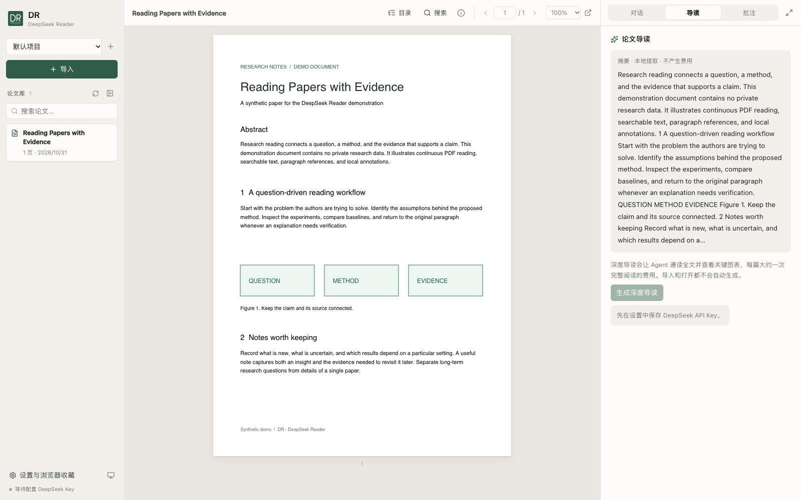

# DR · DeepSeek Reader

[](https://www.npmjs.com/package/@adamw_999/deep_reader)
[](https://github.com/AdamW627/deep-reader/actions/workflows/ci.yml)
[](LICENSE)

**Read papers, follow the evidence, and keep your research conversations together.**

DR is a local-first PDF reader with a research assistant powered by DeepSeek Harness. Organize your library on the left, read continuously in the center, and discuss the paper on the right. Translate a passage, work through an equation, or ask about a figure; paragraph citations take you back to the source.

[中文文档](README.md) · [npm](https://www.npmjs.com/package/@adamw_999/deep_reader) · [Contributing](CONTRIBUTING.md) · [Issues](https://github.com/AdamW627/deep-reader/issues)



*Actual application screenshot with a synthetic demo paper and a locally extracted preview.*

## Features

- **Project libraries:** import individual PDFs, folders, public PDF links, or arXiv pages.
- **Focused reading:** continuous PDF scrolling, outlines, full-text search, highlights, notes, and light/dark themes.
- **Passage actions:** translate, explain, derive equations, inspect figures, critique, or explore applications.
- **Evidence you can revisit:** click paragraph citations to navigate and highlight the source; inspect the assistant's file and image tool activity.
- **On-demand reading guides:** preview a locally extracted abstract, then request a deeper guide when needed.
- **Research context:** separate conversations per paper, a reader profile, and editable project memory across sessions.
- **Browser extension:** save papers from Chrome or Chromium to the local reader.

This is an independent project, not an official DeepSeek product. Model requests use an online provider and can include paper text, page images, selections, conversation context, and relevant memory. Automatic memory maintenance also uses the provider and may incur charges. See [Privacy](PRIVACY.md) and [Security](SECURITY.md).

## Quick start on macOS

Requires **macOS 14+**, Apple Silicon or Intel, and **Node.js 20+**.

```sh
npm install -g @adamw_999/deep_reader
deepseek-reader
```

The first launch downloads uv, Python 3.12, and the pinned Python dependencies, then opens the local reader in your browser. The npm install step itself does not download a Python runtime or dependencies through lifecycle scripts.

1. Open settings, enter your DeepSeek API key, and test the connection.
2. Import a PDF, folder, or paper URL. Local import and reading do not call a model.
3. Select a passage to translate or ask a question. Click citations to return to the paper.

```sh
deepseek-reader setup            # Prepare the runtime in advance
deepseek-reader start --no-open  # Start without opening a browser
deepseek-reader status           # Show server status and URL
deepseek-reader stop             # Stop the server
```

The npm launcher stores its runtime, library, settings, and logs in `~/Library/Application Support/deepseek-paper-reader/`, outside the installed package. Keep that directory when upgrading. See the [launcher documentation](npm/README.md).

## Run from source

Use Python 3.12 and Node.js 20+. The source workflow targets macOS/Linux; on Windows use WSL for the Bash launcher.

```sh
git clone https://github.com/AdamW627/deep-reader.git
cd deep-reader
python3.12 -m venv .venv
.venv/bin/python -m pip install -r requirements.txt
cd frontend
npm ci
npm run build
cd ..
.venv/bin/python -m uvicorn backend.app:app --host 127.0.0.1 --port 8765
```

Open `http://127.0.0.1:8765`. Source installations store papers in `.data/` and model settings in `~/.config/deepseek-pdf-reader/settings.json`. The server serves `frontend/dist`; rebuild after frontend changes and restart after backend changes.

The assistant currently uses the `deepseek-flash` model with the Messages-compatible base URL `https://api.deepseek.com/anthropic`. Configure these in the app's settings. Translation requests stream directly from the provider; Harness responses show progress at complete model-step boundaries.

For the optional browser extension, follow [extension/README.md](extension/README.md).

## Limitations

- The npm launcher currently supports macOS only.
- Scanned PDFs without a text layer do not have OCR, full-text search, or paragraph citations.
- Highlights and notes are stored as JSON and are not embedded into an exported PDF.
- The application is for a single local user. Keep it on loopback; the agent workspace is not an OS sandbox.
- API access, model availability, and provider charges are separate from this project.

## Development and license

See [Contributing](CONTRIBUTING.md) for setup and checks, [Releasing](RELEASING.md) for source packaging, and [Changelog](CHANGELOG.md) for changes.

Repository source is licensed under [GNU AGPL-3.0-only](LICENSE). Third-party components retain their own licenses. The already published npm 0.1.0 metadata still says UNLICENSED; the updated license and repository metadata are prepared for a future npm release.
