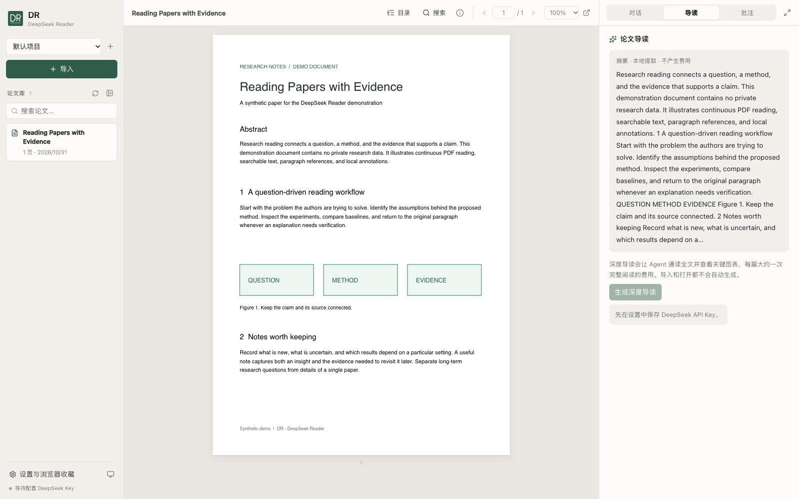

<div align="center">


# DR · DeepSeek Reader

**读论文、问细节、查出处 —— 在同一个工作台完成。**

本地优先的 AI 论文阅读器，每一条回答都能跳回原文段落。

[](https://www.npmjs.com/package/@adamw_999/deep_reader)
[](https://github.com/AdamW627/deep-reader/actions/workflows/ci.yml)
[](LICENSE)


[快速开始](#快速开始macos) · [功能说明](#使用) · [English](README.en.md) · [更新日志](CHANGELOG.md) · [参与贡献](CONTRIBUTING.md)

</div>



<p align="center"><sub>左：项目论文库 · 中：连续阅读 PDF · 右：研究助手（截图使用合成演示论文）</sub></p>

## 为什么用 DR

- **回答有出处**：引用精确到段落（如 `p.5#16`），悬停预览原文，点击跳转并高亮，不用再怀疑 AI 是不是编的。
- **选中即问**：选一段文字，一键翻译、解释、推导公式、讲解图表、审稿或迁移到你的研究；翻译约 1 秒出结果。
- **看得懂全文和图表**：Agent 按需阅读全文、图表与页面原图，并实时展示它读了什么、看了哪张图。
- **用多少付多少**：导入、阅读、本地摘要都不调用模型；深度导读只在你点击时才生成。
- **记得你的研究**：按项目管理论文，每篇论文多会话，项目级长期记忆结合你的研究背景调整讲解深度。
- **一条命令启动**：`npm install -g` 后直接运行，Python 环境自动准备，数据全部保存在本机。

> [!NOTE]
> 本机单用户工具，**非 DeepSeek 官方产品**。模型功能会把论文内容及相关上下文发送给你配置的供应商，并按其规则计费。使用前请阅读 [隐私说明](PRIVACY.md) 与 [安全边界](SECURITY.md)。

## 看看它能做什么

下面以 ResNet 论文（[arXiv:1512.03385](https://arxiv.org/abs/1512.03385)）为例。回答内容与段落编号为示意，实际输出以模型为准。

### 1. 一个链接，导入并打开论文

```text
http://127.0.0.1:8765/?url=https%3A%2F%2Farxiv.org%2Fpdf%2F1512.03385
```

打开链接即导入到当前项目并开始阅读。也可以选择多个 PDF、导入整个文件夹，或用 [浏览器扩展](extension/README.md) 一键收藏。导入和阅读都不调用模型。

### 2. 选中一句，约 1 秒出译文

**选中原文：**

> Instead of hoping each few stacked layers directly fit a desired underlying mapping, we explicitly let these layers fit a residual mapping.

**右侧逐字显示：**

> 我们不再期望每几层堆叠的网络直接拟合所需的底层映射，而是显式地让这些层去拟合一个残差映射。

翻译只发送选中的文字，同一段再次翻译直接读取本地缓存，不再产生费用。

### 3. 公式推导，每一步都有出处

**选中** $\mathcal{F}(x) = \mathcal{H}(x) - x$，**点击「推导」：**

> **为什么学残差比直接学映射更容易？**
>
> 1. 原本要学习 $\mathcal{H}(x)$，作者改为学习 $\mathcal{F}(x)=\mathcal{H}(x)-x$，输出写成 $y=\mathcal{F}(x)+x$ `p.3#8`
> 2. 如果最优映射接近恒等映射，只需把 $\mathcal{F}$ 的权重推向 0，比让多层非线性网络拟合恒等映射容易得多 `p.3#9`
> 3. 实验印证：普通网络 34 层的训练误差高于 18 层，残差网络则相反 `p.6#21`，见 Figure 4

回答里的 `p.3#8` 是可点击的引用：悬停预览原文，点击跳到该段并高亮。

### 4. 看懂图表，过程透明

**选中 Figure 1 的图注，点击「图表」。** Agent 会先找证据，回复区实时显示它在做什么：

```text
▸ 阅读 fulltext.md（第 1–2 页）
▸ 查看 figures/fig1.png
▸ 查看 pages/p1.jpg
```

> 左右两图分别是 CIFAR-10 上的训练误差和测试误差。56 层普通网络的**两条曲线都高于** 20 层，说明问题不是过拟合（否则训练误差应更低），而是更深的网络更难优化，也就是论文所说的“退化问题” `p.1#4`

### 5. 结合你的研究来讲

在设置里填写研究背景：“我在做医学影像分割，常用 U-Net”。**选中残差块那一段，点击「迁移」：**

> 可以把 U-Net 编码器中的每个卷积块替换为残差块。注意论文在维度变化时用 1×1 卷积做投影捷径 `p.4#13`，你的下采样层同样需要这样处理，否则 $x$ 与 $\mathcal{F}(x)$ 的形状对不上……

同样的选段还可以点「审稿」，让它从审稿人角度挑实验设计和结论的问题。

### 6. 深度导读：先看路线，再读全文

右栏「导读」默认显示本地提取的摘要（免费）。点击「生成深度导读」后，Agent 通读全文和关键图表，得到：

| 项目 | 内容（示意） |
| --- | --- |
| 要解决的问题 | 网络越深，训练误差反而越高（退化问题） |
| 核心想法 | 让层学习残差 $\mathcal{F}(x)$，通过恒等捷径与输入相加 |
| 关键公式 | $y = \mathcal{F}(x, \lbrace W_i \rbrace) + x$ |
| 主要结果 | ImageNet 上 top-5 错误率 3.57%，获 ILSVRC 2015 分类第一 |
| 存疑之处 | 1202 层的 CIFAR 网络反而不如 110 层，作者归因于过拟合 |
| 阅读路线 | §1 动机 → Figure 1 → §3.1–3.2 → Table 3、4 → §4.2 |

之后在这篇论文里的所有对话都会参考这份导读。

### 7. 跨论文的研究记忆

每个项目有独立的长期记忆，由 DR 从对话中自动整理，也可以手动编辑：

```text
目标   在小样本 CT 数据上提升小器官分割的 Dice
约束   单卡 24GB 显存，推理需低于 200ms
线索   残差编码器 + 深监督值得尝试（来自 ResNet、UNet++）
```

在同一项目的任意论文里提问时，Agent 会按关键词带上最相关的 3 条记忆，回答自然贴合你的课题。

## 快速开始（macOS）

需要 **macOS 14+**（Apple Silicon / Intel）和 **Node.js 20+**。

```sh
npm install -g @adamw_999/deep_reader
deepseek-reader
```

首次启动会下载 uv、Python 3.12 和 Python 依赖，随后在浏览器打开本地阅读器；无需手动配置 Python 环境。安装 npm 包本身不执行运行时下载。首次准备需要联网，之后运行时会复用。

1. 在设置中填写 DeepSeek API Key，点击“测试连接”。模型功能按供应商规则计费。
2. 导入 PDF、文件夹或论文链接；导入与本地阅读不调用模型。
3. 选中文字翻译或提问，点击回答中的引用返回原文。

```sh
deepseek-reader setup            # 提前准备运行环境
deepseek-reader start --no-open  # 启动，不自动打开浏览器
deepseek-reader status           # 查看服务地址和状态
deepseek-reader stop             # 停止服务
```

npm 安装的数据与运行环境保存在 `~/Library/Application Support/deepseek-paper-reader/`，独立于全局 npm 包，更新包时请保留该目录。源码运行的数据位置见下文。更多启动器说明见 [npm/README.md](npm/README.md)。

## 从源码运行

### 运行环境

需要 Python 3.12、Node.js 20+。支持 macOS / Linux 和 Windows 原生源码运行。macOS / Linux 克隆后进入项目根目录：

```sh
git clone https://github.com/AdamW627/deep-reader.git
cd deep-reader
python3.12 -m venv .venv
.venv/bin/python -m pip install -r requirements.txt
cd frontend
npm ci
npm run build
npx playwright install chromium
cd ..
```

### Windows 安装与启动

安装 Python 3.12 和 Node.js 20+，在 PowerShell 中运行：

```powershell
git clone https://github.com/AdamW627/deep-reader.git
cd deep-reader
py -3.12 -m venv .venv
.\.venv\Scripts\python.exe -m pip install -r requirements.txt
npm.cmd --prefix frontend ci
npm.cmd --prefix frontend run build
.\scripts\paper.cmd
```

无需激活虚拟环境或全局更改 PowerShell 执行策略。启动器从自身位置定位项目，支持空格和中文路径。也可用 `powershell -NoProfile -ExecutionPolicy Bypass -File .\scripts\paper.ps1 start` 直接调用。

```powershell
.\scripts\paper.cmd start    # 后台启动，不打开浏览器
.\scripts\paper.cmd status   # 查看状态
.\scripts\paper.cmd restart  # 重启
.\scripts\paper.cmd logs     # 跟踪标准输出和错误日志，Ctrl-C 退出
.\scripts\paper.cmd stop     # 停止此启动器记录的服务
```

默认地址为 `http://127.0.0.1:8765`，可通过 `-Port 8766` 指定其他端口；后续管理命令使用相同参数。日志与进程记录位于 `.data/`。进程记录包含启动时间，避免 PID 被复用后误停其他程序。旧版仅包含 PID 的记录不会用于停止进程；首次升级时请手动关闭旧服务。Windows 源码支持不包含 macOS 专用的 npm 自动安装器。

Windows 验证：

```powershell
.\.venv\Scripts\python.exe -m pip install -r requirements-dev.txt
.\.venv\Scripts\python.exe -m pytest tests -q
cd frontend
npx.cmd playwright install chromium
npx.cmd playwright test
cd ..
```

未启用开发者模式或没有符号链接权限时，相应测试会明确跳过。后端统一以 UTF-8 保存文本，遇到 Windows 短暂文件占用时有限重试原子替换。

### macOS / Linux 启动

推荐安装全局 `paper` 命令（一次性）：

```sh
mkdir -p "$HOME/.local/bin"
ln -s "$PWD/scripts/paper" "$HOME/.local/bin/paper"
# 将 $HOME/.local/bin 加入 PATH；也可以直接执行 ./scripts/paper
```

之后在任意目录：

```sh
paper          # 服务未运行时自动后台启动，然后打开浏览器
paper stop     # 停止由 paper 启动的后台服务
paper restart  # 重启服务
paper status   # 查看运行状态
paper logs     # 查看并跟踪日志
```

也可以手动启动：

```sh
# 在解压后的项目根目录运行
.venv/bin/python -m uvicorn backend.app:app --host 127.0.0.1 --port 8765
```

打开 http://127.0.0.1:8765 。服务返回的是 `frontend/dist` 里的构建产物：改了前端要在 frontend 中运行 `npm run build`，改了后端要 `paper restart`，否则页面仍是旧版本。`paper` 只管理自己启动的服务，手动运行的实例不会被 `paper stop` 误杀；日志与 PID 记录在 `.data/`。

## 使用

### 项目与导入

- 左上角选择或新建项目；记住上次选择。默认项目包含此前导入的论文。项目是本机论文分组，统一存储在 `.data/papers/<paper-id>/`，不是任意磁盘路径挂载。
- 左栏“导入”按钮展开后有三种方式：
  - **选择 PDF**：一次可选多篇。
  - **导入文件夹**：包含子文件夹，只复制 PDF，跳过其他文件。文件夹是复制导入，原目录后续变化不会自动同步。
  - **从链接打开**：公开 PDF、arXiv 或含 citation_pdf_url 的论文页面。
- 多篇导入时逐个上传解析，进度显示在左栏；失败的文件单独列出，不中断其余文件。导入和打开论文都不调用模型。
- 可直接使用 `http://127.0.0.1:8765/?url=https%3A%2F%2Farxiv.org%2Fpdf%2F1512.03385`，自动导入到当前记住的项目并打开。每次打开此链接会重新导入。
- 浏览器一键收藏见 extension/README.md。扩展默认保存到默认项目。
- 论文标题依次取：PDF 文档标题；首页上部字号最大的连续文字（跳过 “Published as…”、“arXiv”、“Under review” 这类页眉）；导入时提供的标题或文件名。规则更新后，服务启动时会按新规则重算一次旧论文的标题。

### 阅读

- PDF 使用鼠标滚轮连续阅读；工具栏页码、目录、回复引用、批注均可跳转。默认缩放为 150%。
- 快捷键：`⌘B` / `Ctrl+B` 收起或展开左侧论文库（状态本机记住）；`⌘F` / `Ctrl+F` 在论文全文中搜索（Enter / Shift+Enter 切换结果）；`⌘J` / `Ctrl+J` 放大回复区；`Esc` 关闭选区浮层、搜索栏或导入菜单。
- 选中论文后，阅读器顶部“文档详情”即使在 PDF 加载中也可打开。详情包含标题、原始文件名、页数、可读大小与精确字节数、本地时间的导入日期、项目、来源、论文 ID、实际 PDF 绝对路径及元数据 / 批注目录。来源只允许无账号密码的 HTTP(S) 链接；本地上传显示“本地文件导入”。可复制 PDF / 目录路径，剪贴板不可用时按提示手动选择复制；也可打开原始 PDF。关闭按钮或 Escape 关闭，切换论文 / 项目会清除详情。
- 详情路径来自 `GET /api/papers/{id}/details`，由后端按当前存储根目录解析（支持 `PDF_READER_DATA_DIR`），前端不推测用户目录。新上传保留文件名大小写；链接导入使用最终 URL 中的 PDF 文件名，无法获取时为 `paper.pdf`。旧论文使用已有文件名记录，无法恢复过去未保存的原名。
- 左下角可切换浅色 / 深色 / 跟随系统外观。

### 选中文字

- 选中文字后，浮层提供解释、推导、图表、审稿、迁移、翻译六个快捷动作，也可以带着选段自由提问，或高亮并保存备注（多种颜色）。
- **翻译**只把选中的文字发给模型，不读论文、不带对话历史，译文逐字显示在右侧对话里，短句实测约 1 秒出全文。同一段文字的译文缓存在论文目录的 `translations.json`，再次翻译直接返回，不再调用模型。
- 其他快捷动作和自由提问交给 Agent：它会按需读全文、图表和页面原图，所以比翻译慢。

### 导读

- 右栏“导读”标签默认显示从 PDF 提取的摘要或开头，不调用模型，不产生费用。
- 需要时点“生成深度导读”：Agent 通读全文并查看关键图表，生成问题、核心想法、方法、关键公式、主要结果、存疑之处和阅读路线；之后的对话会参考它。只有点击生成或重新生成时才产生费用，批量导入不会自动生成。

### 对话与记忆

- 回复中的引用精确到段落（如 `p.5#16`）：悬停可预览原文，点击后跳转并短暂高亮该段。
- 同一论文可新建独立对话，切换时只加载当前会话历史；支持手动改名、根据首个问题自动命名、标题搜索、归档和删除。默认历史对话允许改名，不允许归档或删除。
- 设置中填写“你的研究背景”，Agent 会据此选择例子和讲解深度。
- 每个项目有独立的研究记忆，保存长期目标、问题、方法、约束和研究线索，可在设置里查看、编辑、增删或立即整理。回答时按关键词选最多 3 条相关记忆；每个项目累计 10 轮对话或距首次活动 24 小时，由 Harness 在后台整理一次，会产生少量费用。

## 模型配置

设置中保存 API Key、模型和 Base URL，然后点击“测试连接”。测试使用真实 Harness SDK 小请求，会产生少量 API 费用。

当前安装 Harness 的 deepseek-official provider 使用 Messages 协议：

- Base URL: `https://api.deepseek.com/anthropic`
- 模型: `deepseek-flash`

原来的 `https://api.deepseek.com` 会出现 HTTP 404，应用会自动迁移这个旧配置。Key 存于 `~/.config/deepseek-pdf-reader/settings.json`（Windows 为用户主目录下的 `.config/deepseek-pdf-reader/settings.json`），页面不回传 Key。POSIX 系统使用 0600 权限；Windows 的访问控制取决于目录继承的 ACL，`chmod` 不会设置等效的私有 ACL。请勿把本地服务暴露到公网。

翻译不经过 Harness：后端用同一组 Key、模型和 Base URL 直接请求 `<Base URL>/v1/messages`，关闭思考并流式返回。

导入时为每篇论文生成 Agent 资料：带段落编号的 `fulltext.md`、每页图片 `pages/pN.jpg`、按图注裁剪的 `figures/`（索引在 `figures.md`）以及 `blocks.json`（段落坐标，用于引用高亮）。旧论文在首次打开或提问时自动补齐，每篇约 2–15 MB。讲解协议写在论文目录的 `AGENTS.md`，由 Harness 自动加载；Agent 用 `read_image` 查看公式、图表原图（`deepseek-flash` 支持图像输入）。扫描件没有文字层，暂不支持全文搜索和段落引用。独立会话保存在 `.data/harness/`。高亮备注单独保存 JSON，暂未嵌入导出 PDF。

当前 Harness SDK（0.2.1rc2）只转发完整的模型步骤，没有逐字流：回复区实时显示 Agent 正在阅读的文件、查看的图片和每一步的文字。翻译不走 Harness，所以能逐字显示。

## 验证

```sh
.venv/bin/python -m pip install -r requirements-dev.txt
.venv/bin/python -m pytest tests -q
node --test extension/tests/popup.test.cjs
cd frontend
node --test tests/*.test.mjs
npm run build
npx playwright test
```

浏览器自动测试使用模拟 API 和有效 PDF；真实模型需在本机设置 Key 后测试。

## 项目结构

```text
backend/     FastAPI 服务、PDF 解析、模型调用与项目记忆
frontend/    React + Vite 阅读界面，PDF.js 渲染与 KaTeX 公式
extension/   Chrome / Chromium 论文收藏扩展
npm/         macOS 启动器与 npm 打包入口
scripts/     源码启动与白名单发布打包
tests/       后端与发布检查
```

## 限制与反馈

- npm 启动器目前仅支持 macOS；其他系统请使用源码方式。
- 扫描件暂不提供 OCR，因此没有文字层的 PDF 不支持全文搜索和段落引用。
- 高亮备注保存在本地 JSON，暂未嵌入导出 PDF。
- 应用仅供本机单用户使用，请勿将服务暴露到公网；Agent 工作目录不是操作系统沙箱。

问题与功能建议请提交到 [GitHub Issues](https://github.com/AdamW627/deep-reader/issues)，贡献方式见 [CONTRIBUTING.md](CONTRIBUTING.md)。

## 许可证

项目源码采用 [GNU AGPL-3.0-only](LICENSE)。第三方组件沿用各自许可证；模型服务不包含在本项目授权中，需要单独配置账号与 API Key。

已发布的 npm `0.1.0` 元数据仍标记为 `UNLICENSED`；本仓库已采用 AGPL-3.0-only，npm 元数据与许可证文件将在后续版本发布时同步。
